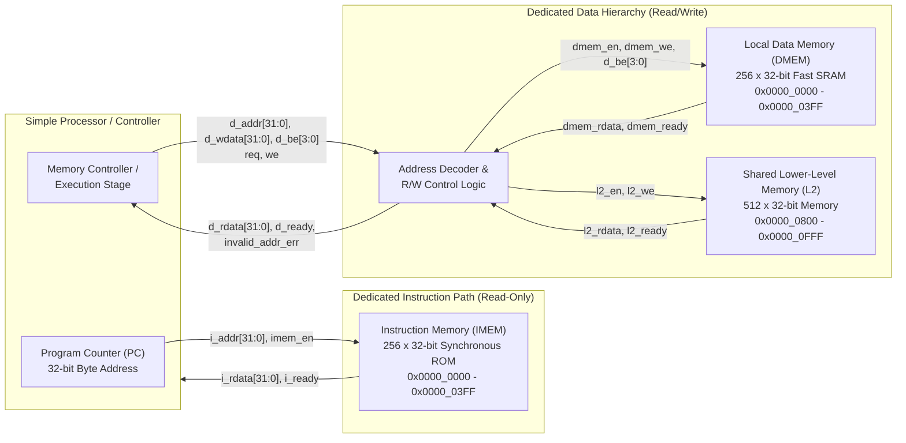

# Project 9: Instruction and Data Memory Hierarchy (Team TLE)

**Course:** Modern Computer Architecture  
**Team Name:** TLE  
**Objective:** Design, implement, and verify a 32-bit Harvard-style memory organization with physically decoupled instruction and data pathways in Verilog RTL, and evaluate its cycle-level timing behavior and throughput against a shared-memory (Von Neumann) baseline.

---

## 1. System Architecture Block Diagram



---

## 2. Memory Map & Address Decoding

| Memory Region | Address Range (Hex) | Capacity | Access Type | Bitmask (`MASK`) | Enable Signal |
| :--- | :--- | :--- | :--- | :--- | :--- |
| **Instruction Memory (`IMEM`)** | `0x0000_0000 - 0x0000_03FF` | 1 KB (256 Words) | Read-Only (`RX`) | Dedicated Bus | `imem_en` |
| **Local Data Memory (`DMEM`)** | `0x0000_0000 - 0x0000_03FF` | 1 KB (256 Words) | Read / Write (`RW`) | `0xFFFF_FC00` | `dmem_en` |
| **Unmapped / Fault Gap** | `0x0000_0400 - 0x0000_07FF` | — | Fault / Trap | Default | `invalid_addr_err` |
| **Shared L2 Memory (`L2`)** | `0x0000_0800 - 0x0000_0FFF` | 2 KB (512 Words) | Read / Write (`RW`) | `0xFFFF_F800` | `l2_en` |
| **Unmapped / Fault Region** | `0x0000_1000 - 0xFFFF_FFFF` | — | Fault / Trap | Default | `invalid_addr_err` |

---

## 3. Repository Structure

```text
tle-harvard-memory-hierarchy/
├── README.md                              # Project overview, architecture diagram & contributions
├── Makefile                               # Icarus Verilog compilation & simulation targets
├── programs/
│   ├── test_program.hex                   # 256-word padded hex payload for Phase I IMEM fetch
│   └── benchmark_suite.hex                # 256-word padded L1/L2 workload for Phase II evaluation
├── scripts/
│   └── analyze_cpi.py                     # Quantitative Harvard vs. Von Neumann CPI & stall analyzer
├── rtl/
│   ├── common/
│   │   ├── defines.vh                     # Global bus widths, memory depths, and address masks
│   │   └── program_counter.v              # 32-bit Program Counter with stall & branch support
│   ├── harvard/
│   │   ├── instruction_memory.v           # 256x32-bit synchronous Instruction ROM (Member 1)
│   │   ├── data_memory.v                  # 256x32-bit synchronous Data RAM with byte-enables (Member 2)
│   │   ├── shared_l2_memory.v             # 512x32-bit Shared Lower-Level Memory (Member 2 / Member 3)
│   │   ├── address_decoder.v              # Combinational bitmask address decoding (Member 3)
│   │   ├── rw_control.v                   # 3-clock R/W transaction & response controller (Member 3)
│   │   └── harvard_top.v                  # Top-level Harvard hierarchy integration (Member 4)
│   └── von_neumann/                       # Phase II unified-memory baseline comparison
├── tb/
│   ├── tb_phase1_harvard.v                # Self-checking PC + IMEM fetch, stall & branch testbench
│   ├── tb_dmem.v                          # Self-checking Data Memory unit testbench (1584 checks)
│   ├── tb_addr_rw.v                       # Self-checking Decoder + R/W Control testbench (26 checks)
│   └── tb_harvard_top.v                   # Self-checking Top-Level Harvard integration testbench (25 checks)
└── docs/
    ├── proposed_solution_ieee.md          # Section III: Proposed Architecture & Analytical Model
    ├── phase2_research_paper_ieee.md      # Complete IEEE Research Paper (Markdown Master)
    └── phase2_research_paper_ieee.tex     # Complete IEEEtran Conference Research Paper (LaTeX)
```

---

## 4. How to Run Simulations & Phase II Benchmarks

**Prerequisites:** Install Icarus Verilog (`brew install icarus-verilog` on macOS) and Python 3.

```bash
# Run all self-checking Verilog testbenches (Fetch, DMEM, Addr/RW, and Harvard Top)
make sim_all

# Run individual subsystem testbenches
make sim_fetch
make sim_dmem

# Run the Phase II Harvard vs. Von Neumann CPI & Stall Quantitative Analyzer
python3 scripts/analyze_cpi.py
```

---

## 5. Individual Contributions (Phase I & Phase II)

Every member of **Team TLE** owns dedicated RTL modules, self-checking verification testbenches, and sections of the IEEE Research Paper, as reflected in the Git commit history:

| Team Member | Role & Subsystem | Phase I Contributions (RTL, Verification & Report) | Phase II Contributions (Benchmarking, Comparison & Research Paper) |
| :--- | :--- | :--- | :--- |
| **Palak Gupta** *(Member 1)* | **Instruction Path, Memory Map & CPI Benchmarking** | • Initialized repository structure, `Makefile`, and global architecture macros (`rtl/common/defines.vh`)<br>• Designed 32-bit byte-aligned Program Counter (`rtl/common/program_counter.v`) with synchronous `stall` priority and `branch_en` control<br>• Implemented $256 \times 32$-bit synchronous Instruction ROM (`rtl/harvard/instruction_memory.v`) and self-checking fetch testbench (`tb/tb_phase1_harvard.v`)<br>• Authored Section III (*Proposed Architecture*) and system block diagram | • Designed the 16-instruction L1/L2 memory hierarchy benchmark suite (`programs/benchmark_suite.hex`)<br>• Developed the quantitative CPI and structural-hazard stall analyzer (`scripts/analyze_cpi.py`)<br>• Restructured the project report into full **IEEE Conference Research Paper** format (`docs/phase2_research_paper_ieee.tex` / `.md`) and authored Section VI (*Conclusion & Future Work*) |
| **Member 2** | **Data Memory Subsystem & L2 Storage** | • Designed $256 \times 32$-bit synchronous Local Data Memory (`rtl/harvard/data_memory.v`) with 4-bit byte-lane write strobes (`d_be[3:0]`) and 1-clock read latency<br>• Built self-checking unit testbench (`tb/tb_dmem.v`) passing 1,584 directed and randomized checks against a behavioral reference model<br>• Authored *Abstract* and *Section I (Introduction)* | • Implemented and verified the $512 \times 32$-bit Shared Lower-Level Memory (`rtl/harvard/shared_l2_memory.v`)<br>• Analyzed L1 (`DMEM`) vs. L2 read/write latency behavior and byte-masked store timing for Section IV (*Experimental Evaluation*) |
| **Member 3** | **Address Decoding, R/W Control & Von Neumann Baseline** | • Implemented combinational bitmask Address Decoder (`rtl/harvard/address_decoder.v`) for `DMEM` (`0x0000_0000–0x0000_03FF`), 2 KB-aligned `L2` (`0x0000_0800–0x0000_0FFF`), and unmapped fault detection (`invalid_addr_err`)<br>• Designed the 3-clock finite-state Read/Write Controller (`rtl/harvard/rw_control.v`) and `tb/tb_addr_rw.v` (26 checks, 0 errors)<br>• Authored *Section II (Literature Review)* | • Modeled bus arbitration and structural hazard stalls for the unified Von Neumann baseline comparison<br>• Expanded *Section II (Related Work & Theoretical Background)* and curated the IEEE bibliography |
| **Member 4** | **Top-Level Integration & Comparative Verification** | • Integrated all instruction and data subsystems inside `rtl/harvard/harvard_top.v`<br>• Built the top-level self-checking verification suite (`tb/tb_harvard_top.v`, 25 checks, 0 errors) proving concurrent `IMEM` fetch and `DMEM`/`L2` data access<br>• Compiled *Individual Contributions* and Phase I deliverables | • Conducted end-to-end cycle-accurate waveform comparisons between Harvard and shared-memory organizations<br>• Co-authored *Section IV (Results and Discussion)* tables and synthesized comparative performance metrics |

---

## 6. Project Artefacts & Documentation
* **IEEE Research Paper (Markdown):** [`docs/phase2_research_paper_ieee.md`](docs/phase2_research_paper_ieee.md)
* **IEEE Research Paper (Overleaf LaTeX):** [`docs/phase2_research_paper_ieee.tex`](docs/phase2_research_paper_ieee.tex)
* **IEEE Research Paper (PDF):** [`docs/phase2_research_paper_ieee.pdf`](docs/phase2_research_paper_ieee.pdf)
