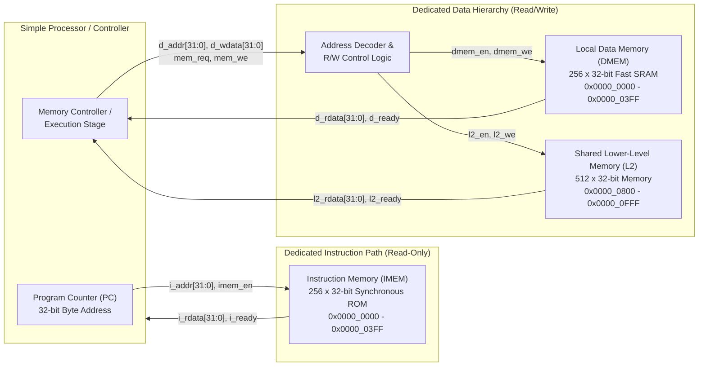

# Project 9: Instruction and Data Memory Hierarchy (Team TLE)

**Course:** Modern Computer Architecture  
**Team Name:** TLE  
**Objective:** Implement a 32-bit Harvard-style memory organization with separate instruction and data paths in Verilog RTL and analyze its timing behavior against a shared-memory (Von Neumann) baseline.

---

## 1. System Architecture Block Diagram



---

## 2. Memory Map & Address Decoding

| Memory Region | Address Range (Hex) | Capacity | Access Type | Enable Signal |
| :--- | :--- | :--- | :--- | :--- |
| **Instruction Memory (`IMEM`)** | `0x0000_0000 - 0x0000_03FF` | 1 KB (256 Words) | Read-Only (`RX`) | `imem_en` |
| **Local Data Memory (`DMEM`)** | `0x0000_0000 - 0x0000_03FF` | 1 KB (256 Words) | Read / Write (`RW`) | `dmem_en` |
| **Shared L2 Memory (`L2`)** | `0x0000_0800 - 0x0000_0FFF` | 2 KB (512 Words) | Read / Write (`RW`) | `l2_en` |
| **Unmapped / Fault Regions** | `0x0000_0400 - 0x0000_07FF`, `0x0000_1000 - 0xFFFF_FFFF` | — | Fault / Trap | `invalid_addr_err` |

---

## 3. Repository Structure

```text
tle-harvard-memory-hierarchy/
├── README.md                          # Project documentation & architecture diagram
├── Makefile                           # Icarus Verilog compilation & simulation targets
├── programs/
│   └── test_program.hex               # Machine code hex payload for IMEM initialization
├── rtl/
│   ├── common/
│   │   ├── defines.vh                 # Global bus widths, memory depths, and address masks
│   │   └── program_counter.v          # 32-bit Program Counter with stall & branch support (Palak Gupta)
│   ├── harvard/
│   │   ├── instruction_memory.v       # 256x32-bit synchronous Instruction ROM (Palak Gupta)
│   │   ├── data_memory.v              # 256x32-bit synchronous Data RAM, byte-lane writes (Atanu Adhikari)
│   │   ├── address_decoder.v          # Combinational bitmask address decoder (Sambhav Kumar)
│   │   ├── rw_control.v               # Read/write control FSM: IDLE -> ACTIVE -> WAIT (Sambhav Kumar)
│   │   ├── shared_l2_memory.v         # 512x32-bit shared lower-level (L2) memory (Sambhav Kumar)
│   │   └── harvard_top.v              # Top-level Harvard hierarchy integration (Prince Singh)
│   └── von_neumann/                   # Phase II shared-memory baseline (not yet created)
├── tb/
│   ├── tb_phase1_harvard.v            # PC + IMEM fetch, stall and branch (Palak Gupta)
│   ├── tb_dmem.v                      # Self-checking DMEM testbench with reference model (Atanu Adhikari)
│   ├── tb_addr_rw.v                   # Decoder + R/W control + DMEM + L2 (Sambhav Kumar)
│   └── tb_harvard_top.v               # Full Phase I integration test (Prince Singh)
└── docs/
    ├── phase1_report_ieee.md          # Combined Phase I IEEE report (all sections)
    ├── Phase1_Report_TLE.pdf          # Same report as PDF
    ├── abstract_introduction_ieee.md  # Abstract & Section I (Atanu Adhikari)
    ├── literature_review_ieee.md      # Section II (Sambhav Kumar)
    ├── proposed_solution_ieee.md      # Section III (Palak Gupta)
    ├── individual_contributions_ieee.md # Section VI (all members)
    └── figures/                       # Waveform figures rendered from the simulation VCDs
```

---

## 4. How to Run Simulations

**Prerequisites:** Install Icarus Verilog (`brew install icarus-verilog` on macOS).

```bash
make sim_all          # runs all four testbenches below
```

| Target | What it verifies | Waveform | Phase I result |
| :--- | :--- | :--- | :--- |
| `make sim_fetch` | PC + IMEM fetch, stall, branch | `sim/phase1_fetch.vcd` | ALL TESTS PASSED |
| `make sim_dmem` | Data memory: latency, byte lanes, 500 random ops vs reference model | `sim/dmem.vcd` | 1584 checks, 0 errors |
| `make sim_addr_rw` | Address decoder + R/W control + DMEM + L2 | `sim/addr_rw.vcd` | 26 checks, 0 errors |
| `make sim_harvard_top` | Full Phase I integration (fetch + data path) | `sim/harvard_top.vcd` | 25 checks, 0 errors |

Waveforms open in GTKWave (`gtkwave sim/harvard_top.vcd`) or the VaporView VS Code extension. Each testbench ends with `$fatal` on any mismatch, so `make` stops at the first failing target.

---

## 5. Phase I Deliverables & Links
* **Phase I IEEE Project Report:** [`docs/phase1_report_ieee.md`](docs/phase1_report_ieee.md) · PDF: [`docs/Phase1_Report_TLE.pdf`](docs/Phase1_Report_TLE.pdf)
* **Phase I Prototype Demo Video:** *(Link to be added before Nov 16 submission)*
