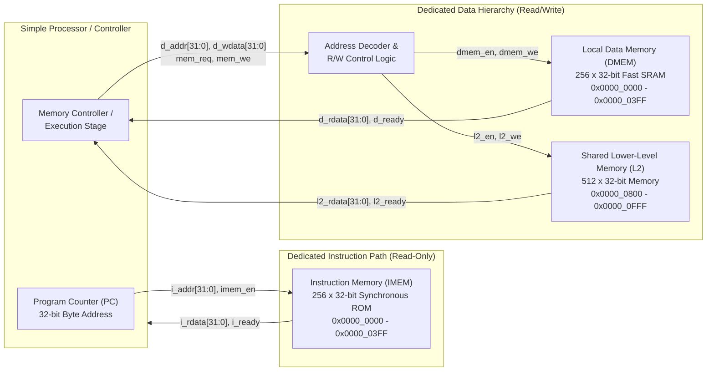

# Project 9: Instruction and Data Memory Hierarchy (Team TLE)

**Course:** Modern Computer Architecture  
**Team Name:** TLE  
**Objective:** Implement a 32-bit Harvard-style memory organization with separate instruction and data paths in Verilog RTL and analyze its timing behavior against a shared-memory (Von Neumann) baseline.

---

## 1. System Architecture Block Diagram



---

## 2. Memory Map & Address Decoding

| Memory Region | Address Range (Hex) | Capacity | Access Type | Enable Signal |
| :--- | :--- | :--- | :--- | :--- |
| **Instruction Memory (`IMEM`)** | `0x0000_0000 - 0x0000_03FF` | 1 KB (256 Words) | Read-Only (`RX`) | `imem_en` |
| **Local Data Memory (`DMEM`)** | `0x0000_0000 - 0x0000_03FF` | 1 KB (256 Words) | Read / Write (`RW`) | `dmem_en` |
| **Shared L2 Memory (`L2`)** | `0x0000_0800 - 0x0000_0FFF` | 2 KB (512 Words) | Read / Write (`RW`) | `l2_en` |
| **Unmapped / Fault Regions** | `0x0000_0400 - 0x0000_07FF`, `0x0000_1000 - 0xFFFF_FFFF` | — | Fault / Trap | `invalid_addr_err` |

---

## 3. Repository Structure

```text
tle-harvard-memory-hierarchy/
├── README.md                          # Project documentation & architecture diagram
├── Makefile                           # Icarus Verilog compilation & simulation targets
├── programs/
│   └── test_program.hex               # Machine code hex payload for IMEM initialization
├── rtl/
│   ├── common/
│   │   ├── defines.vh                 # Global bus widths, memory depths, and address masks
│   │   └── program_counter.v          # 32-bit Program Counter with stall & branch support
│   ├── harvard/
│   │   ├── instruction_memory.v       # 256x32-bit synchronous Instruction ROM
│   │   ├── data_memory.v              # 256x32-bit synchronous Data RAM (Member 2)
│   │   ├── address_decoder.v          # Combinational address decoding & R/W control (Member 3)
│   │   └── harvard_top.v              # Top-level Harvard hierarchy integration (Member 4)
│   └── von_neumann/                   # Phase II shared-memory baseline comparison
├── tb/
│   └── tb_phase1_harvard.v            # Testbench verifying PC + IMEM fetch, stall, and branch
└── docs/
    └── proposed_solution_ieee.md      # IEEE Report Section III (Proposed Solution)
```

---

## 4. How to Run Simulations

**Prerequisites:** Install Icarus Verilog (`brew install icarus-verilog` on macOS).

```bash
make sim_fetch
```

This compiles the RTL and generates the waveform file `sim/phase1_fetch.vcd` (viewable in GTKWave or the VaporView VS Code extension).

---

## 5. Phase I Deliverables & Links
* **Phase I IEEE Project Report:** *(Link / PDF to be added before Nov 16 submission)*
* **Phase I Prototype Demo Video:** *(Link to be added before Nov 16 submission)*
