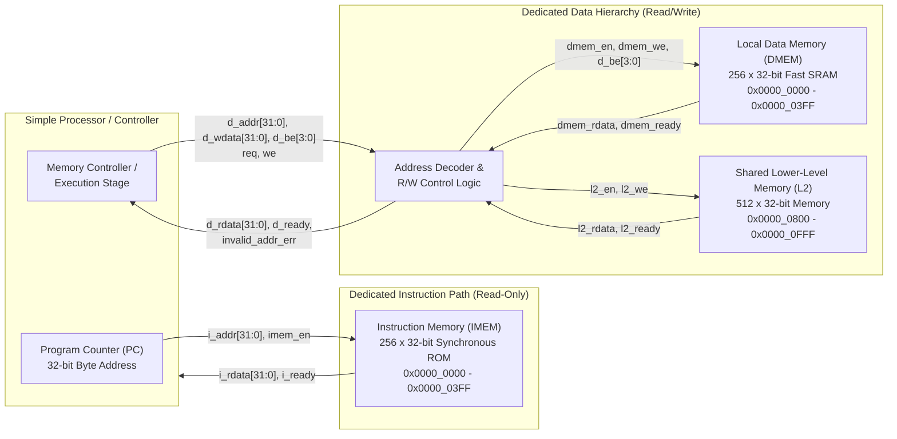
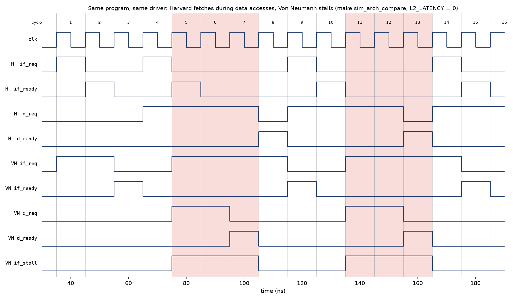

# Project 9: Instruction and Data Memory Hierarchy (Team TLE)

**Course:** Modern Computer Architecture  
**Team Name:** TLE  
**Objective:** Design, implement, and verify a 32-bit Harvard-style memory organization with physically decoupled instruction and data pathways in Verilog RTL, and evaluate its cycle-level timing behavior and throughput against a shared-memory (Von Neumann) baseline.

---

## 1. System Architecture Block Diagram



---

## 2. Memory Map & Address Decoding

| Memory Region | Address Range (Hex) | Capacity | Access Type | Bitmask (`MASK`) | Enable Signal |
| :--- | :--- | :--- | :--- | :--- | :--- |
| **Instruction Memory (`IMEM`)** | `0x0000_0000 - 0x0000_03FF` | 1 KB (256 Words) | Read-Only (`RX`) | Dedicated Bus | `imem_en` |
| **Local Data Memory (`DMEM`)** | `0x0000_0000 - 0x0000_03FF` | 1 KB (256 Words) | Read / Write (`RW`) | `0xFFFF_FC00` | `dmem_en` |
| **Unmapped / Fault Gap** | `0x0000_0400 - 0x0000_07FF` | — | Fault / Trap | Default | `invalid_addr_err` |
| **Shared L2 Memory (`L2`)** | `0x0000_0800 - 0x0000_0FFF` | 2 KB (512 Words) | Read / Write (`RW`) | `0xFFFF_F800` | `l2_en` |
| **Unmapped / Fault Region** | `0x0000_1000 - 0xFFFF_FFFF` | — | Fault / Trap | Default | `invalid_addr_err` |

---

## 3. Repository Structure

```text
tle-harvard-memory-hierarchy/
├── README.md                              # Project overview, architecture diagram & contributions
├── Makefile                               # Icarus Verilog compilation & simulation targets
├── programs/
│   ├── test_program.hex                   # 256-word padded hex payload for Phase I IMEM fetch
│   └── benchmark_suite.hex                # 256-word padded L1/L2 workload for Phase II evaluation
├── scripts/
│   ├── analyze_cpi.py                     # Analytical (pre-RTL) CPI estimate
│   ├── vcd_timeline.py                    # Phase II: cycle-by-cycle IF/MEM timeline from the comparison VCD
│   ├── plot_waveforms.py                  # Phase II: waveform figures drawn from sim/*.vcd (matplotlib)
│   ├── draw_block_diagram.py              # Phase II: system block diagram figure (matplotlib)
│   ├── synth_summary.py                   # Phase II: synthesis results table + optimized-away check
│   └── build_paper_pdf.py                 # Markdown paper -> HTML for the PDF build
├── rtl/
│   ├── common/
│   │   ├── defines.vh                     # Global bus widths, memory depths, and address masks
│   │   ├── program_counter.v              # 32-bit Program Counter with stall & branch support
│   │   └── simple_cpu_driver.v            # Phase II: accumulator CPU driver, LOAD/STORE/ALU/NOP (Member 4)
│   ├── harvard/
│   │   ├── instruction_memory.v           # 256x32-bit synchronous Instruction ROM (Member 1)
│   │   ├── data_memory.v                  # 256x32-bit synchronous Data RAM with byte-enables (Member 2)
│   │   ├── shared_l2_memory.v             # 512x32-bit Shared L2, L2_LATENCY wait states (Member 3 / Member 2)
│   │   ├── address_decoder.v              # Combinational bitmask address decoding (Member 3)
│   │   ├── rw_control.v                   # IDLE/ACTIVE/WAIT R/W transaction controller (Member 3)
│   │   ├── harvard_top.v                  # Top-level Harvard hierarchy integration (Member 4)
│   │   └── harvard_cpu_top.v              # Phase II: CPU driver + Harvard hierarchy (Member 4)
│   └── von_neumann/                       # Phase II Von Neumann baseline (Member 3)
│       ├── unified_memory.v               # 2048x32-bit single-port memory, code segment at 0x1000
│       ├── bus_arbiter.v                  # Data-priority arbiter, if_stall = structural-hazard flag
│       └── von_neumann_top.v              # Phase II: CPU driver + arbiter + unified memory (Member 4)
├── tb/
│   ├── tb_phase1_harvard.v                # Self-checking PC + IMEM fetch, stall & branch testbench
│   ├── tb_dmem.v                          # Self-checking Data Memory unit testbench (1712 checks)
│   ├── tb_addr_rw.v                       # Self-checking Decoder + R/W Control testbench (26 checks)
│   ├── tb_harvard_top.v                   # Self-checking Top-Level Harvard integration testbench (25 checks)
│   ├── tb_l2_latency.v                    # Phase II: L2 multi-cycle latency + data-path latency table (74 checks)
│   ├── tb_von_neumann.v                   # Phase II: Von Neumann arbiter + unified memory (319 checks)
│   └── tb_architecture_comparison.v       # Phase II: Harvard vs. Von Neumann, same driver (57 checks)
├── synth/
│   ├── *_ecp5.rpt, *_artix7.rpt           # Phase II: Yosys cell reports (make synth)
│   ├── *_ecp5_pnr.log                     # Phase II: nextpnr place-and-route log with Fmax
│   └── synthesis_summary.md               # Phase II: utilization + Fmax table used in the paper
└── docs/
    ├── figures/                           # Block diagram and waveform figures used in the paper
    ├── phase2_research_paper_ieee.md      # Complete IEEE Research Paper (Markdown Master)
    ├── phase2_research_paper_ieee.tex     # Complete IEEEtran Conference Research Paper (LaTeX)
    └── phase2_research_paper_ieee.pdf     # Final report PDF
```

---

## 4. How to Run Simulations & Phase II Benchmarks

**Prerequisites:** Install Icarus Verilog (`brew install icarus-verilog` on macOS) and Python 3.

```bash
# Run all seven self-checking Verilog testbenches (Phase I and Phase II)
make sim_all

# Run individual subsystem testbenches
make sim_fetch
make sim_dmem

# Phase II: L2 latency model and DMEM vs L2 latency table
make sim_l2_latency

# Phase II: Von Neumann baseline (bus arbiter + unified memory)
make sim_von_neumann

# Phase II: same CPU driver on Harvard vs. Von Neumann (prints the CPI table,
# writes sim/arch_comparison.csv and sim/arch_comparison.vcd)
make sim_arch_compare
python3 scripts/vcd_timeline.py --cycles 24

# Analytical (pre-RTL) CPI estimate - the measured results come from sim_arch_compare
python3 scripts/analyze_cpi.py

# Phase II: waveform figures and block diagram (needs: pip install matplotlib)
python3 scripts/plot_waveforms.py          # --all also redraws the Phase I figures into sim/phase1_redraw/
python3 scripts/draw_block_diagram.py

# Phase II: synthesis, utilization and Fmax (Yosys + nextpnr-ecp5)
make synth
# without a native install:  pip install yowasp-yosys yowasp-nextpnr-ecp5
#   make synth YOSYS=yowasp-yosys NEXTPNR=yowasp-nextpnr-ecp5
```

### Phase II measured results (`make sim_arch_compare`)

Same CPU driver, same 16-instruction program (`programs/benchmark_suite.hex`), same memory technology. Both systems end with identical memory and accumulator contents.

| L2 wait states | Harvard cycles (CPI) | Von Neumann cycles (CPI) | VN structural stalls | Speedup |
| :--- | :--- | :--- | :--- | :--- |
| 0 | 74 (4.625) | 90 (5.625) | 36 | 1.216x |
| 2 | 82 (5.125) | 98 (6.125) | 44 | 1.195x |
| 4 | 90 (5.625) | 106 (6.625) | 52 | 1.178x |

All seven testbenches pass: 2,213 self-checking assertions plus 12 fetch state vectors, 0 errors.

### Phase II synthesis results (`make synth`)

Lattice ECP5 LFE5U-25F, Yosys `synth_ecp5` + nextpnr-ecp5 (out-of-context place and route, 100 MHz target, seed 1). The Artix-7 columns are a Yosys `synth_xilinx` resource estimate (no Vivado place and route, so no Artix-7 Fmax).

| System | ECP5 logic cells | ECP5 FF | ECP5 BRAM | ECP5 Fmax | Artix-7 LUT | Artix-7 FF | Artix-7 BRAM (RAMB36 eq.) |
| :--- | :--- | :--- | :--- | :--- | :--- | :--- | :--- |
| Harvard (`harvard_cpu_top`) | 639 | 538 | 2 | 134.0 MHz | 155 | 538 | 1 |
| Von Neumann (`von_neumann_top`) | 640 | 490 | 4 | 105.7 MHz | 153 | 490 | 2 |

At these clocks the benchmark runs in 552 ns (Harvard, 74 cycles) vs. 851 ns (Von Neumann, 90 cycles).



---

## 5. Individual Contributions (Phase I & Phase II)

Every member of **Team TLE** owns dedicated RTL modules, self-checking verification testbenches, and sections of the IEEE Research Paper, as reflected in the Git commit history:

| Team Member | Role & Subsystem | Phase I Contributions (RTL, Verification & Report) | Phase II Contributions (Benchmarking, Comparison & Research Paper) |
| :--- | :--- | :--- | :--- |
| **Palak Gupta** *(Member 1)* | **Instruction Path, Memory Map & CPI Benchmarking** | • Initialized repository structure, `Makefile`, and global architecture macros (`rtl/common/defines.vh`)<br>• Designed 32-bit byte-aligned Program Counter (`rtl/common/program_counter.v`) with synchronous `stall` priority and `branch_en` control<br>• Implemented $256 \times 32$-bit synchronous Instruction ROM (`rtl/harvard/instruction_memory.v`) and self-checking fetch testbench (`tb/tb_phase1_harvard.v`)<br>• Authored Section III (*Proposed Architecture*) and system block diagram | • Designed the 16-instruction L1/L2 memory hierarchy benchmark suite (`programs/benchmark_suite.hex`)<br>• Developed the analytical CPI estimate (`scripts/analyze_cpi.py`)<br>• Restructured the project report into full **IEEE Conference Research Paper** format (`docs/phase2_research_paper_ieee.md` / `.tex` / `.pdf`) and authored Section VI (*Conclusion & Future Work*) |
| **Atanu Adhikari** *(Member 2)* | **Data Memory Subsystem & L2 Latency** | • Designed $256 \times 32$-bit synchronous Local Data Memory (`rtl/harvard/data_memory.v`) with 4-bit byte-lane write strobes (`d_be[3:0]`) and 1-clock read latency<br>• Built self-checking unit testbench (`tb/tb_dmem.v`) passing 1,712 directed and randomized checks against a behavioral reference model<br>• Authored *Abstract* and *Section I (Introduction)* | • Added the multi-cycle latency model (`L2_LATENCY` wait states) to `rtl/harvard/shared_l2_memory.v`<br>• Built `tb/tb_l2_latency.v` (74 checks): L2 ready timing for latency 0/2/4 and end-to-end `DMEM` vs. L2 latency through `rw_control`<br>• Wrote Section IV-B (*Results & Discussion Part 1: Latency & Memory Hierarchy Behavior*)<br>• Added the synthesis flow (`make synth`, `scripts/synth_summary.py`), the figure scripts (`scripts/plot_waveforms.py`, `scripts/draw_block_diagram.py`) and Section IV-E (*Synthesis Results*) |
| **Sambhav Kumar** *(Member 3)* | **Address Decoding, R/W Control & Von Neumann Baseline** | • Implemented combinational bitmask Address Decoder (`rtl/harvard/address_decoder.v`) for `DMEM` (`0x0000_0000–0x0000_03FF`), 2 KB-aligned `L2` (`0x0000_0800–0x0000_0FFF`), and unmapped fault detection (`invalid_addr_err`)<br>• Designed the IDLE/ACTIVE/WAIT Read/Write Controller (`rtl/harvard/rw_control.v`) and `tb/tb_addr_rw.v` (26 checks, 0 errors)<br>• Authored *Section II (Literature Review)* | • Built the Von Neumann baseline: single-port `rtl/von_neumann/unified_memory.v` (code segment at `0x1000`) and data-priority `rtl/von_neumann/bus_arbiter.v` with the `if_stall` structural-hazard flag<br>• Built `tb/tb_von_neumann.v` (319 checks, including 200 random overlapping fetch/data pairs vs. a reference model)<br>• Expanded *Section II* (II-C to II-F) and formatted the IEEE references |
| **Prince Singh** *(Member 4)* | **Top-Level Integration & Comparative Verification** | • Integrated all instruction and data subsystems inside `rtl/harvard/harvard_top.v`<br>• Built the top-level self-checking verification suite (`tb/tb_harvard_top.v`, 25 checks, 0 errors) proving concurrent `IMEM` fetch and `DMEM`/`L2` data access<br>• Compiled *Individual Contributions* and Phase I deliverables | • Built the CPU driver `rtl/common/simple_cpu_driver.v` and the two comparison systems `rtl/harvard/harvard_cpu_top.v` and `rtl/von_neumann/von_neumann_top.v`<br>• Built `tb/tb_architecture_comparison.v` (57 checks): same program on both systems, identical results, measured CPI table; `scripts/vcd_timeline.py` for the waveform table<br>• Wrote Section IV-C (*Results & Discussion Part 2: CPI, Throughput & Waveform Comparison*) and updated the Abstract, Conclusion, LaTeX and PDF to the measured results |

---

## 6. Project Artefacts & Documentation
* **IEEE Research Paper (Markdown):** [`docs/phase2_research_paper_ieee.md`](docs/phase2_research_paper_ieee.md)
* **IEEE Research Paper (Overleaf LaTeX):** [`docs/phase2_research_paper_ieee.tex`](docs/phase2_research_paper_ieee.tex)
* **IEEE Research Paper (PDF):** [`docs/phase2_research_paper_ieee.pdf`](docs/phase2_research_paper_ieee.pdf)
* **Phase I Prototype Demo Video:** [Watch on Google Drive](https://drive.google.com/file/d/1j7-Sij1sefN8flYvEZj6Y0V-DFXxNOJ8/view?usp=sharing)
