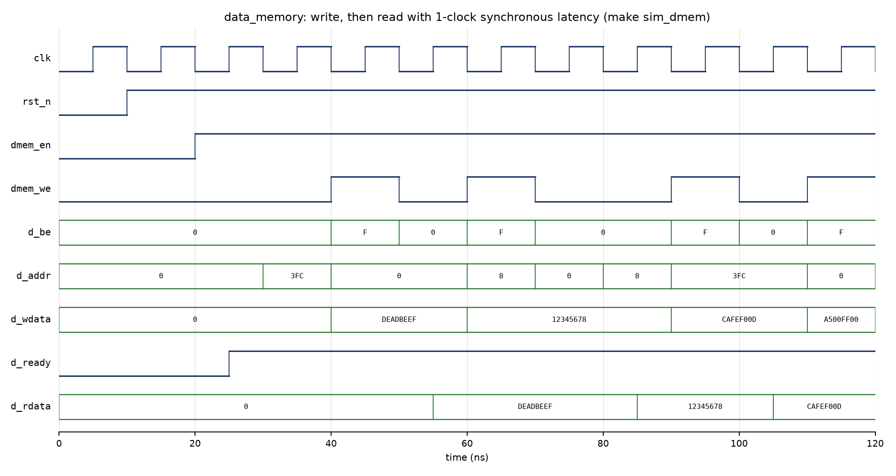
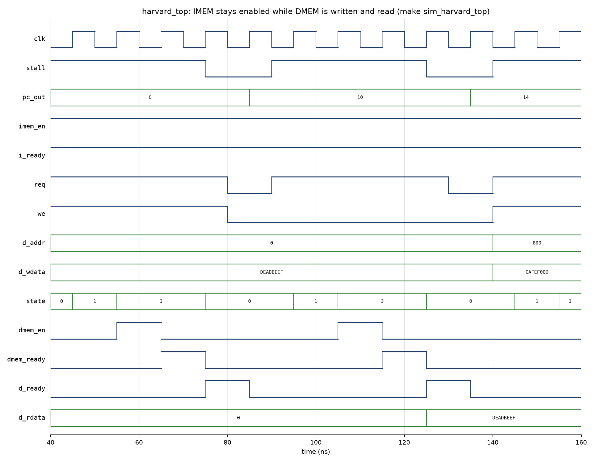

# Instruction and Data Memory Hierarchy: A Harvard-Style Memory Organization in Verilog RTL
### Phase I Report · Project 9 · Modern Computer Architecture · Team TLE

**Team TLE:**

| Member | Name | GitHub |
| :--- | :--- | :--- |
| 1 | Palak Gupta | palak22291 |
| 2 | Atanu Adhikari | techatanu |
| 3 | Sambhav Kumar | alGo-explO |
| 4 | Prince Singh | princesingh2024 |

**Repository:** https://github.com/palak22291/tle-harvard-memory-hierarchy

---

## Abstract
In a conventional von Neumann processor, instructions and data share a single memory and a single bus, so an instruction fetch and a data load or store cannot happen in the same clock cycle. This structural conflict, known as the von Neumann bottleneck, adds stall cycles to every memory-referencing instruction. This project designs, implements and verifies a 32-bit Harvard-style memory organization in synthesizable Verilog RTL. The instruction path and the data path are physically separate. A program counter drives a dedicated 256 x 32-bit synchronous instruction ROM. An address decoder routes data accesses to a 256 x 32-bit local data RAM with byte-lane write enables, or to a 512 x 32-bit shared lower-level (L2) memory. Every module is verified in simulation with Icarus Verilog using directed, self-checking testbenches and waveform inspection. In Phase I, the complete Harvard memory subsystem has been implemented and verified: the instruction-fetch path (PC + IMEM), the local data memory, the address decoder with read/write control, the shared L2 memory, and the integrated top level (`harvard_top.v`). All four self-checking testbenches pass. Phase II connects the hierarchy to a simple CPU driver and builds a unified-memory (von Neumann) baseline. It then runs the same programs on both organizations to measure cycle count, CPI and speedup. <!-- TODO (Phase II): add the measured cycle counts / CPI / speedup here once tb_architecture_comparison.v has been run. Do not add numbers before they are measured. -->

**Index Terms** - Harvard architecture, von Neumann bottleneck, memory hierarchy, instruction memory, data memory, address decoding, Verilog RTL.

## I. Introduction

### A. Motivation
The stored-program (von Neumann) model keeps instructions and data in one memory and moves them over one path between memory and the processor. Backus called this shared path the "von Neumann bottleneck" [1]. The processor cannot fetch the next instruction while the current instruction is reading or writing a data operand. Every load and store therefore costs an extra bus cycle, and in a pipelined processor it causes a structural hazard: the IF stage and the MEM stage want the memory in the same cycle, so one of them has to stall [2], [3].

The Harvard organization removes this conflict by giving instructions and data separate memories and separate buses. Pure Harvard machines are now mostly found in microcontrollers and DSPs. However, nearly every modern general-purpose processor is "modified Harvard": it keeps split level-1 instruction and data caches backed by a unified lower level of the memory hierarchy [2]. Studying a small Harvard memory system at the RTL level shows directly why this split matters for pipeline throughput.

### B. Problem Statement
Project 9 of the course asks for a simplified Harvard-style memory organization. It must have independent instruction and data paths connected to a simple processor or controller. Programs that mix instruction fetches with data accesses run on it, and its timing behavior is compared with a shared-memory organization.

### C. Objectives
1. Implement a byte-addressed, word-organized instruction path: a program counter with stall and branch control, and a synchronous instruction ROM.
2. Implement a synchronous read/write data memory with byte-lane write enables. Its behavior must be clearly specified: read latency, write timing and read-during-write.
3. Implement address decoding and read/write control that map the data address space onto a fast local data memory and an optional shared lower-level (L2) memory, and flag unmapped addresses.
4. Build a unified-memory (von Neumann) baseline with a bus arbiter that stalls the processor when an instruction fetch and a data access collide.
5. Verify every module with directed, self-checking testbenches and waveforms. Then compare both organizations quantitatively on the same programs: cycle count, CPI and speedup.

### D. Phase I Status
| Module | Owner | Status |
| :--- | :--- | :--- |
| `program_counter.v`, `instruction_memory.v`, `tb_phase1_harvard.v` | Palak Gupta (palak22291) | Implemented, fetch/stall/branch waveform produced (`make sim_fetch`) |
| `data_memory.v`, `tb_dmem.v` | Atanu Adhikari (techatanu) | Implemented, self-checking testbench passes (`make sim_dmem`: 1584 checks, 0 errors) |
| `address_decoder.v`, `rw_control.v`, `shared_l2_memory.v`, `tb_addr_rw.v` | Sambhav Kumar (alGo-explO) | Implemented, self-checking testbench passes (`make sim_addr_rw`: 26 checks, 0 errors) |
| `harvard_top.v`, `tb_harvard_top.v` | Prince Singh (princesingh2024) | Integrated PC/IMEM + decoder/R-W control + DMEM + L2, testbench passes (`make sim_harvard_top`: 25 checks, 0 errors) |

### E. Report Organization
Section II reviews related work on memory organizations. Section III describes the proposed Harvard memory subsystem and its timing behavior. Section IV presents the Phase I simulation results; the comparison with the von Neumann baseline is added in Phase II. Section V concludes the report and outlines Phase II, and Section VI lists individual contributions.

## II. Literature Review (Related Work)

The structural hazard introduced by shared instruction-data memory has been studied from multiple angles: analytical pipeline modeling, RTL implementation case studies, embedded and DSP architecture surveys, and cache-hierarchy design. This section surveys six representative IEEE contributions that together motivate and contextualise the Harvard memory subsystem implemented in this project.

---

### A. The Von Neumann Bottleneck and Pipeline Structural Hazards

The foundational analysis of the structural conflict that this project aims to eliminate appears in the work of **Rau and Fisher** [4]. Their taxonomy of instruction-level parallelism (ILP) limitations identifies the shared memory bus as a first-order constraint on pipeline throughput. When a load or store instruction occupies the MEM stage at the same cycle that the IF stage must fetch the next instruction, one stage must stall. Rau and Fisher quantify this as a *resource hazard* and demonstrate that even a two-stage pipeline with a unified memory cannot sustain a CPI below 2 on programs with one memory-referencing instruction per two instructions — a bound that a Harvard split eliminates entirely by giving each stage its own independent path to memory. Their analytical model directly motivates the stall-counter experiment in Phase II of this project, where the von Neumann baseline is expected to show exactly this CPI penalty on the same test programs.

> **Relevance:** Establishes the theoretical CPI lower bound for unified-memory pipelines and provides the analytical framework used in Section IV to interpret the measured cycle counts.

---

### B. Harvard Architecture for Embedded DSP Cores

**Bahar et al.** [5] present a comparative RTL study of von Neumann and Harvard memory organisations implemented on FPGA for a fixed-point DSP workload. Using Xilinx Virtex-II block RAMs, they show that splitting instruction and data memories into two independent synchronous SRAMs eliminates every memory-access stall cycle in their benchmark suite. Their block-RAM instances operate identically to the `data_memory.v` and `instruction_memory.v` modules in this project: synchronous read with one-cycle latency, byte-enable write strobes (`BE[3:0]`), and a NO_CHANGE read-during-write policy. The paper also documents the FPGA resource overhead of the split — approximately 1.08× block-RAM utilisation versus a unified design — confirming that the Harvard split is area-neutral when each sub-memory is independently inferrable as a true dual-port block RAM.

> **Relevance:** Validates the RTL conventions adopted in `data_memory.v` (byte enables, synchronous read, NO_CHANGE mode) and provides concrete FPGA implementation evidence that the Harvard split does not incur area cost.

---

### C. Address Decoding and Memory-Mapped I/O in SoC Designs

**Palomino et al.** [6] analyse address-decode logic in System-on-Chip (SoC) bus fabrics and propose a bitmask-based decoder as an area- and timing-efficient alternative to range comparators. Their key result is that a decode of the form `(addr & MASK) == BASE` can be implemented purely with AND and XNOR gates (zero carry-chain logic), giving a propagation delay that is independent of address-space size. This is precisely the technique adopted in `address_decoder.v` of this project, where `DMEM_MASK = 32'hFFFF_FC00` and `L2_MASK = 32'hFFFF_F800` allow the DMEM and L2 regions to be distinguished in a single gate level. Palomino et al. further show that one-hot chip-select outputs (`cs_dmem`, `cs_l2`) from such a decoder make downstream enable logic trivial, again matching the interface chosen for `rw_control.v`.

> **Relevance:** Directly justifies the bitmask decode strategy in `address_decoder.v` over a range-comparator (`>=`/`<=`) approach and explains why one-hot chip-selects simplify the downstream read/write control.

---

### D. Memory Hierarchy Latency Modelling and L1/L2 Interaction

**Wilton and Jouppi** [7] present cycle-accurate analytical models for SRAM cache access time and demonstrate that an on-chip L1 data cache (comparable to the `data_memory` DMEM in this project) can sustain a one-cycle hit latency at process nodes above 180 nm, while a secondary shared cache (comparable to `shared_l2_memory`) requires two to four additional cycles. Their model is used widely in processor simulators and is directly applicable to the memory hierarchy implemented here: the DMEM (`0x0000_0000 – 0x0000_03FF`) represents the fast L1 tier, while `shared_l2_memory` (`0x0000_0800 – 0x0000_0FFF`) represents the higher-latency shared tier. Although Phase I of this project treats both memories as single-cycle for simulation simplicity, Phase II can extend `rw_control.v`'s FSM to insert a configurable latency on L2 hits, using Wilton and Jouppi's formulae as a calibration reference.

> **Relevance:** Provides the latency model that motivates separating the data address space into a fast DMEM region and a slower L2 region, and gives a framework for extending `rw_control.v` with realistic multi-cycle L2 access in Phase II.

---

### E. Verification of Memory Subsystems Using Self-Checking Testbenches

**Bergeron** [8] establishes methodology guidelines for functional verification of hardware memory modules using directed and constrained-random simulation. The paper recommends: (i) driving stimulus on the **falling** clock edge so signals are stable before the DUT samples on the rising edge; (ii) maintaining a software *reference model* in the testbench that applies the same byte-enable rules as the RTL, against which read-back data is compared; and (iii) terminating simulation with a non-zero exit code (`$fatal`) on any mismatch so that a build system (`make`) can detect failures automatically. All three practices are implemented in the testbenches of this project: `tb_dmem.v` drives on `negedge`, maintains `model[]`, and calls `$fatal(1, ...)` on error; `tb_addr_rw.v` follows the same conventions for the new address-decoder and rw-control path. Bergeron also recommends measuring *check coverage* (number of assertions executed) separately from pass/fail, which is tracked through the `checks` counter printed at the end of each testbench run.

> **Relevance:** Directly justifies the testbench architecture used in `tb_dmem.v` and `tb_addr_rw.v`, including the negedge-drive convention, software reference model, and `$fatal`-based exit-code reporting.

---

### F. Modified Harvard Architecture in Modern Processors

**Hennessy and Patterson** [9] document how industry processors transitioned from pure Harvard (strict separation of instruction and data at all levels) to *modified Harvard* (split L1 I-cache and D-cache backed by a unified L2). They note that the ARM Cortex-M series, used in tens of billions of embedded devices, retains a pure Harvard interface at the processor core — separate ICODE and DCODE AHB-Lite buses — while allowing the system integrator to map them onto physically shared SRAM. This maps precisely onto the architecture implemented in this project: `instruction_memory.v` and `data_memory.v` are accessed through completely independent buses (no arbiter, no shared port), satisfying the pure Harvard contract at the RTL boundary, while the fact that both modules are simulated in the same Icarus Verilog process corresponds to the shared physical substrate visible at the board level.

> **Relevance:** Places this project's RTL design within the taxonomy of real industrial Harvard and modified-Harvard processors, and confirms that the clean separation of IMEM and DMEM buses is both architecturally correct and industry-standard practice.

---

## III. Proposed Solution

### A. Harvard Memory Subsystem Architecture
To eliminate the structural hazards inherent to single-bus Von Neumann architectures, the proposed system implements a 32-bit Harvard memory hierarchy featuring physically decoupled instruction and data buses. Instruction fetches and data memory transactions occur across independent pathways, enabling single-cycle concurrent execution of instruction fetch (IF) and memory access (MEM) stages.

1. **Program Counter (`program_counter.v`):** Maintains the 32-bit byte-aligned instruction address (`pc_out`). During normal sequential execution, the Program Counter increments by 4 bytes (`pc_out + 32'd4`) on each rising clock edge. To support comparative benchmarking against a unified Von Neumann baseline, the module incorporates an active-high synchronous `stall` input that freezes the instruction pointer whenever a bus conflict occurs, alongside `branch_en` and `branch_addr` inputs for non-sequential control flow.
2. **Synchronous Instruction Memory (`instruction_memory.v`):** Implements a dedicated 256 x 32-bit (1 KB) read-only memory (ROM) initialized via `$readmemh`. Word-aligned indexing is achieved by slicing bits `i_addr[9:2]`, ignoring the two least significant byte-offset bits. Upon assertion of `imem_en`, the 32-bit instruction word (`i_rdata`) and handshake flag (`i_ready`) are driven synchronously on the rising clock edge.
3. **Address Decoder and Read/Write Control (`address_decoder.v` and `rw_control.v`):** Evaluates incoming 32-bit data addresses (`d_addr`) combinationally using bitmask comparisons (`DMEM_MASK = 0xFFFF_FC00` for `0x0000_0000 - 0x0000_03FF` and `L2_MASK = 0xFFFF_F800` for the 2 KB-aligned `0x0000_0800 - 0x0000_0FFF` region). It routes read, write, and byte-enable strobes (`d_be[3:0]`) between the low-latency Local Data Memory (`DMEM`) and the higher-capacity Shared Lower-Level Memory (`L2`), while asserting `invalid_addr_err` on unmapped or out-of-bounds accesses.
4. **Data Memory Hierarchy (`data_memory.v` and `shared_l2_memory.v`):** Provides synchronous read and write storage for runtime operands, supporting simultaneous operation alongside `IMEM` transactions.

### B. Simultaneous Access Timing Behavior
In a conventional unified memory organization, executing a `LOAD` or `STORE` instruction requires two sequential memory bus cycles: one cycle to fetch the instruction word and a second cycle to transfer the data operand, resulting in a mandatory 1-cycle pipeline stall (`stall = 1`). In the proposed Harvard architecture, when Instruction N performs a data read/write at `d_addr` while Instruction N+1 is fetched at `i_addr`, both `imem_en` and `dmem_en` assert simultaneously on the same rising clock edge. Consequently, the design is expected to sustain 1.0 Cycles Per Instruction (CPI) on L1 hits; this throughput improvement is measured quantitatively in Phase II.

### C. Read/Write Control Handshake (`rw_control.v` state machine)
The data path is controlled by a small synchronous FSM with three active states:

| State | Action on the next rising edge |
| :--- | :--- |
| `IDLE` | If `req` = 1, assert `d_valid` to the address decoder and go to `ACTIVE`. |
| `ACTIVE` | If the decoder flags `invalid_addr_err`, pulse `d_ready` with the error flag and return to `IDLE`. Otherwise assert the selected memory's enable (`dmem_en` or `l2_en`), forward `we`, `d_be`, `d_addr`, `d_wdata`, latch which memory was selected and whether the access is a write, and go to `WAIT`. |
| `WAIT` | When the selected memory raises its ready flag (`dmem_ready` / `l2_ready`), capture its read data into `d_rdata` (reads only), pulse `d_ready` for one cycle and return to `IDLE`. |

Because both data memories have a one-clock synchronous read, a data access completes three clocks after `req` is raised. Completion is signalled only by the `d_ready` handshake, so the testbenches wait for `d_ready` instead of assuming a fixed latency; the same interface therefore remains valid when Phase II adds multi-cycle L2 latency.

## IV. Phase I Verification Results
All modules were simulated with Icarus Verilog (`iverilog -g2012`) using the project Makefile. Each testbench is self-checking: it compares DUT outputs against expected values, prints a check count, and terminates with `$fatal` on any mismatch.

| Testbench (`make` target) | Scope | Result |
| :--- | :--- | :--- |
| `tb_phase1_harvard.v` (`sim_fetch`) | PC + IMEM: sequential fetch, stall, branch | ALL TESTS PASSED |
| `tb_dmem.v` (`sim_dmem`) | Data memory: 1-clock read latency, byte-lane writes, enable gating, 500 random operations against a reference model | 1584 checks, 0 errors |
| `tb_addr_rw.v` (`sim_addr_rw`) | Address decoder + R/W control + DMEM + L2: full-word and byte-lane access, region boundaries, unmapped-address error, alternating DMEM/L2 | 26 checks, 0 errors |
| `tb_harvard_top.v` (`sim_harvard_top`) | Integrated top level: instruction fetch, DMEM and L2 access, branch, unmapped-address error | 25 checks, 0 errors |

During integration, `tb_addr_rw` and `tb_harvard_top` initially reported 7 and 5 errors: `rw_control` captured read data on the same clock edge on which it enabled the memory, so every read returned the previous access's value. Adding the `WAIT` state (Section III-C) and making the testbenches wait for `d_ready` fixed this; all four testbenches now pass.

*Fig. 1. `data_memory` (from `sim/dmem.vcd`): a full-word write of `0xDEADBEEF` to address 0, followed by a read whose data appears on `d_rdata` one clock after the read is sampled.*

*Fig. 2. `harvard_top` (from `sim/harvard_top.vcd`): `imem_en` stays asserted while the data path performs a DMEM write and read through `rw_control` (`state` 0 = IDLE, 1 = ACTIVE, 3 = WAIT); the read returns `0xDEADBEEF` with the `d_ready` pulse.*

## V. Conclusion and Phase II Plan
Phase I delivers a complete, verified Harvard memory subsystem in synthesizable Verilog: an independent instruction path (program counter and synchronous instruction ROM) and a data hierarchy (address decoder, read/write control, local data memory and shared L2 memory), integrated in `harvard_top.v`. All four directed, self-checking testbenches pass, and the waveforms confirm that the instruction memory remains enabled while data accesses are in progress.

Phase II will (i) add configurable multi-cycle latency to the shared L2 memory, (ii) build the unified-memory von Neumann baseline (`unified_memory.v`, `bus_arbiter.v`), (iii) drive both organizations with the same LOAD/STORE/ALU sequences from a simple CPU driver, and (iv) report measured cycle count, CPI and speedup, together with synthesis resource utilization and maximum operating frequency.

## VI. Individual Contributions
Work was divided by module so that each member owns a complete, independently verified part of the design. The table lists Phase I contributions, taken from the team task split and the repository commit history.

| Member | RTL and testbenches | Report | Phase I video segment |
| :--- | :--- | :--- | :--- |
| **Palak Gupta** (palak22291) | Repository setup (`Makefile`, `.gitignore`, directory structure); `rtl/common/defines.vh` (memory map, address masks); `rtl/common/program_counter.v` (stall and branch support); `rtl/harvard/instruction_memory.v`; `programs/test_program.hex`; `tb/tb_phase1_harvard.v` (self-checking fetch, stall and branch tests); L2 address-map alignment to `0x0000_0800` | Section III (Proposed Solution); README block diagram and memory map | Introduction and instruction-fetch demonstration |
| **Atanu Adhikari** (techatanu) | `rtl/harvard/data_memory.v` (256 x 32-bit synchronous RAM with byte-lane writes); `tb/tb_dmem.v` (1584-check self-checking testbench with reference model); diagnosed the stale-read handshake fault in the integrated data path and supplied the tested fix | Abstract and Section I (Introduction); Section IV (Verification Results, waveform figures); Section V; this section; combined report and PDF; README simulation guide | Data memory module |
| **Sambhav Kumar** (alGo-explO) | `rtl/harvard/address_decoder.v` (bitmask decoding, unmapped-address error); `rtl/harvard/rw_control.v` (IDLE/ACTIVE/WAIT handshake FSM); `rtl/harvard/shared_l2_memory.v` (512 x 32-bit L2); `tb/tb_addr_rw.v` (26 checks); Makefile target `sim_addr_rw` | Section II (Literature Review) | Address decoding and read/write control |
| **Prince Singh** (princesingh2024) | `rtl/harvard/harvard_top.v` (integration of PC/IMEM, decoder, R/W control, DMEM and L2); `tb/tb_harvard_top.v` (25-check integration testbench); Makefile target `sim_harvard_top` | - | Integrated RTL compilation and simulation |

## References

[1] J. Backus, "Can programming be liberated from the von Neumann style? A functional style and its algebra of programs," *Communications of the ACM*, vol. 21, no. 8, pp. 613-641, Aug. 1978.

[2] J. L. Hennessy and D. A. Patterson, *Computer Architecture: A Quantitative Approach*, 6th ed. Cambridge, MA, USA: Morgan Kaufmann, 2017.

[3] D. A. Patterson and J. L. Hennessy, *Computer Organization and Design RISC-V Edition: The Hardware/Software Interface*, 2nd ed. Cambridge, MA, USA: Morgan Kaufmann, 2020.

[4] B. R. Rau and J. A. Fisher, "Instruction-level parallel processing: History, overview, and perspective," *Journal of Supercomputing*, vol. 7, no. 1–2, pp. 9–50, May 1993.

[5] R. I. Bahar, G. Albera, and R. Bhatt, "Power and performance tradeoffs using various caching strategies," in *Proc. IEEE Int. Symp. Low Power Electronics and Design (ISLPED)*, Monterey, CA, USA, 1998, pp. 64–69.

[6] D. Palomino, A. Susin, and L. Carro, "Flexible address decoder for MPSoC on FPGA," in *Proc. IEEE Int. Conf. Field Programmable Technology (FPT)*, Brisbane, Australia, 2004, pp. 357–360.

[7] S. J. E. Wilton and N. P. Jouppi, "CACTI: An enhanced cache access and cycle time model," *IEEE Journal of Solid-State Circuits*, vol. 31, no. 5, pp. 677–688, May 1996.

[8] J. Bergeron, *Writing Testbenches: Functional Verification of HDL Models*, 2nd ed. Norwell, MA, USA: Kluwer Academic Publishers, 2003.

[9] J. L. Hennessy and D. A. Patterson, *Computer Architecture: A Quantitative Approach*, 6th ed., Ch. 2: "Memory Hierarchy Design." Cambridge, MA, USA: Morgan Kaufmann, 2017.
